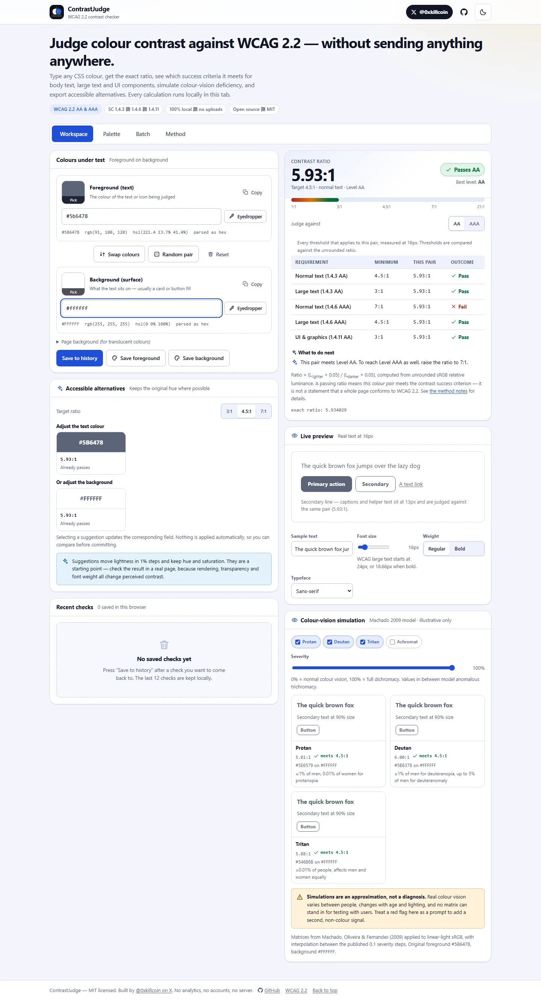
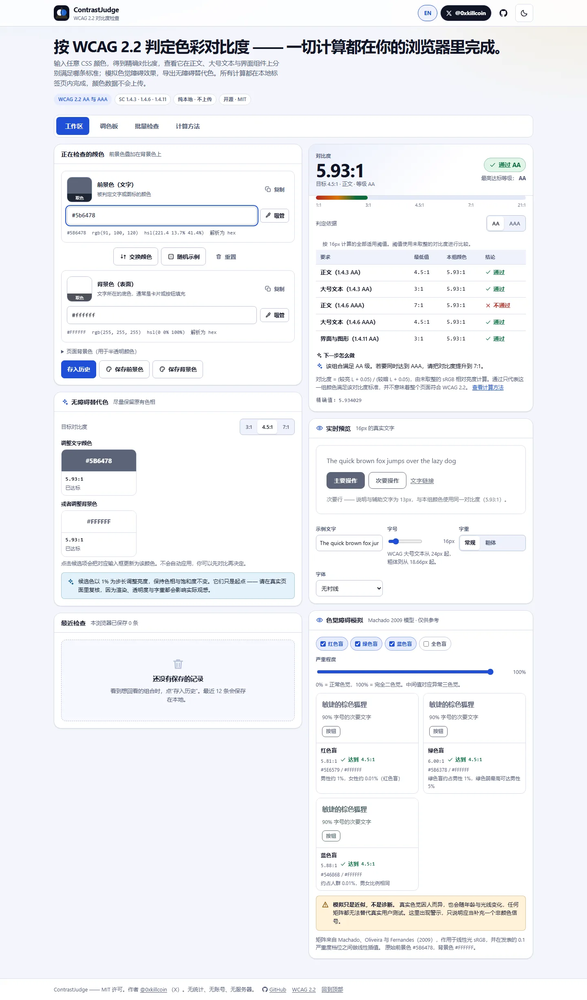
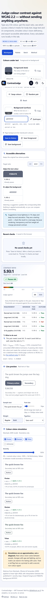
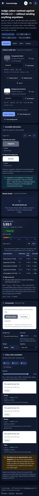
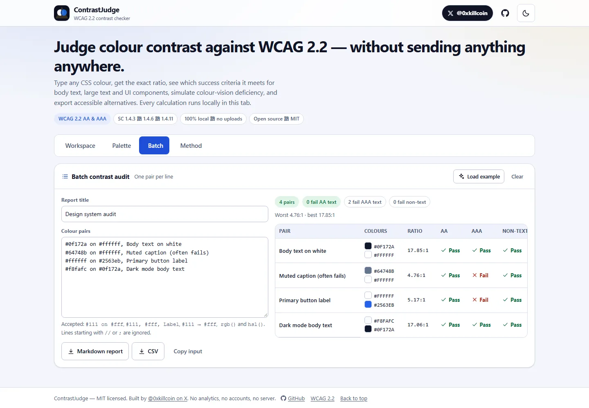
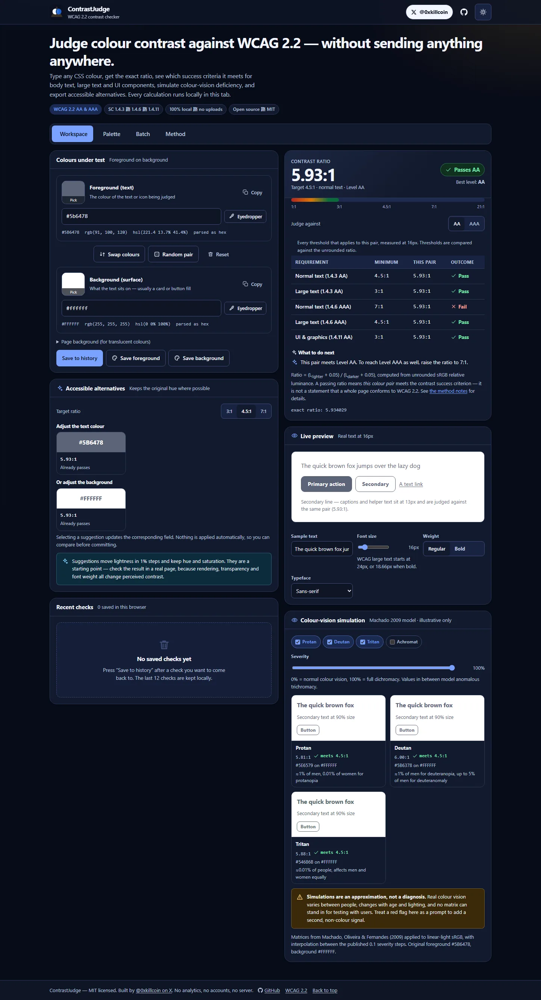

<div align="center">


# ContrastJudge

**English** · [简体中文](README.zh-CN.md)

**Judge colour contrast against WCAG 2.2 — without sending anything anywhere.**

Type any CSS colour, get the exact ratio, see which success criteria it meets for body text, large
text and UI components, simulate colour-vision deficiency, generate accessible alternatives, and
export the result as CSS variables or JSON tokens. The interface itself switches between
English and Simplified Chinese from the header — no reload, no re-entry of any data.

[**Live app**](https://iiiiiiiiiiiiikk.github.io/contrastjudge/) ·
[Method notes](https://iiiiiiiiiiiiikk.github.io/contrastjudge/#learn) ·
[Report a bug](https://github.com/iiiiiiiiiiiiiKK/contrastjudge/issues) ·
[Author on 𝕏 / @0xkillcoin](https://x.com/0xkillcoin)

[](https://github.com/iiiiiiiiiiiiiKK/contrastjudge/actions/workflows/ci.yml)
[](https://github.com/iiiiiiiiiiiiiKK/contrastjudge/actions/workflows/deploy-pages.yml)
[](https://www.w3.org/TR/WCAG22/)
[](LICENSE)
[](#privacy)

</div>

---

<div align="center">
  
  <sub>Desktop workspace — colour inputs, per-criterion verdicts, accessible alternatives, live preview.</sub>
</div>

## Why this exists

Every contrast checker will tell you a number. Far fewer tell you **why** that number matters, which
success criterion it belongs to, and what to do when it fails — and almost none of them will show you
the maths so you can check it.

ContrastJudge is built around three commitments:

1. **The maths is the product.** WCAG 2.2's own luminance and contrast formulas, implemented directly,
   compared against unrounded values, and validated against independent third-party implementations.
2. **Nothing leaves your browser.** No accounts, no analytics, no server, no colour values in a network
   request. Close the tab and nothing about your palette exists anywhere else.
3. **Say what it cannot do.** A passing ratio is not WCAG conformance. The tool states that on screen,
   in every exported report, and in the README below.

## What it does

| Feature                      | Detail                                                                                                                                                     |
| ---------------------------- | ---------------------------------------------------------------------------------------------------------------------------------------------------------- |
| **Colour input**             | `#rgb`, `#rgba`, `#rrggbb`, `#rrggbbaa`, `rgb()`/`rgba()`, `hsl()`/`hsla()` (legacy comma _and_ modern space syntax), 148 CSS named colours, `transparent` |
| **Exact ratios**             | WCAG 2.2 relative luminance + `(L1 + 0.05) / (L2 + 0.05)`, compared unrounded, displayed to two decimals with the exact value shown beneath                |
| **Per-criterion verdicts**   | SC 1.4.3 AA (4.5:1 / 3:1 large), SC 1.4.6 AAA (7:1 / 4.5:1 large), SC 1.4.11 AA non-text (3:1)                                                             |
| **Large-text detection**     | Automatic at 24px, or 18.66px when bold — driven by the live preview controls, not a checkbox                                                              |
| **Accessible alternatives**  | Suggested foreground _and_ background colours that reach a target ratio while keeping hue and saturation                                                   |
| **Live preview**             | Real text, a filled and an outlined button, and a link rendered in your pair; adjustable size, weight and typeface                                         |
| **Colour-vision simulation** | Protan, deutan, tritan and achromatopsia via the Machado (2009) matrices, with adjustable severity, each showing the simulated ratio                       |
| **Palette**                  | Save colours with names, see HEX/RGB/HSL and contrast against the page background, rename, reuse as text or surface                                        |
| **Export**                   | CSS custom properties (hex/rgb/hsl, optional contrast comments) and JSON design tokens with a full contrast matrix                                         |
| **Batch audit**              | Paste one pair per line, get a table plus Markdown and CSV reports you can attach to a review                                                              |
| **History**                  | The last 12 checks, restorable with one click, stored locally                                                                                              |
| **English / 简体中文**       | One-click language switch in the header; every string — including error messages, the batch report and the method notes — is translated                    |
| **Dark mode & responsive**   | Light/dark themes, 320px → wide desktop, verified in real browsers at iPhone and Pixel viewports                                                           |
| **Keyboard & screen reader** | Skip link, roving-tabindex tab list, labelled inputs, live-region announcements, visible focus everywhere                                                  |

<div align="center">
  
  <sub>中文界面（点顶部的「中文 / EN」按钮切换，选择会被记住）。</sub>
</div>

<div align="center">
  
  
  <br />
  <sub>iPhone 14 viewport (390 × 844 @3x) — light and dark. Single column, no horizontal scroll, X link always reachable.</sub>
</div>

## Screenshots

| Batch audit                                                                                                                             | Dark mode                                                                                |
| --------------------------------------------------------------------------------------------------------------------------------------- | ---------------------------------------------------------------------------------------- |
|  |  |

## The maths

WCAG 2.2 defines contrast in two steps. ContrastJudge implements both literally — see
[`src/lib/wcag.ts`](src/lib/wcag.ts) — and every threshold comparison uses the **unrounded** value, as
the [Understanding document for SC 1.4.3](https://www.w3.org/WAI/WCAG22/Understanding/contrast-minimum.html)
requires (`4.499:1` does not meet `4.5:1`).

### 1 — Linearise the sRGB channels

For each of R, G, B, with `Csrgb = C8bit / 255`:

```
if Csrgb <= 0.04045   →   C = Csrgb / 12.92
else                  →   C = ((Csrgb + 0.055) / 1.055) ^ 2.4
```

<sub>The knee was `0.03928` before May 2021. The W3C notes the change has no practical effect on
contrast results; this tool uses the current `0.04045`.</sub>

### 2 — Relative luminance

```
L = 0.2126 · R + 0.7152 · G + 0.0722 · B
```

`L` runs from 0 (black) to 1 (white). Alpha is **not** part of the definition, so translucent colours
are flattened onto their backdrop first — that is what the "page background" field is for.

### 3 — Contrast ratio

```
ratio = (L_lighter + 0.05) / (L_darker + 0.05)
```

| Pair                                                 |    Ratio |
| ---------------------------------------------------- | -------: |
| Black on white                                       | **21:1** |
| White on #2563eb                                     |   5.17:1 |
| #767676 on white (the classic "just passes AA" grey) |   4.54:1 |
| **#777777 on white** (rounds to 4.48 — **fails**)    |   4.48:1 |
| #9aa4b2 on white (a typical muted caption)           |   2.52:1 |

### 4 — Thresholds, and what "large" means

| Success criterion         | Level | Normal text |                                  Large text |
| ------------------------- | ----- | ----------: | ------------------------------------------: |
| 1.4.3 Contrast (Minimum)  | AA    |       4.5:1 |                                         3:1 |
| 1.4.6 Contrast (Enhanced) | AAA   |         7:1 |                                       4.5:1 |
| 1.4.11 Non-text Contrast  | AA    |           — | 3:1 for UI components & meaningful graphics |

_Large-scale_ text is at least **18pt**, or at least **14pt bold**. With `1pt = 1.333px` that is
**24px**, or **18.66px** when bold. ContrastJudge derives this from the preview controls, so changing
the font size changes which threshold is being judged in real time.

### Validation

The implementation is checked against data generated from **two independent libraries**
(`wcag-contrast` and `color-contrast-checker`) rather than against itself:

- 990 colour pairs comparing our ratio to theirs to within `1e-5`
- 200 pairs comparing raw relative luminance to within `1e-9`
- 77 pairs cross-checked between the two reference implementations
- pass/fail agreement on all 990 pairs, at every one of the four text thresholds
- boundary cases: `#767676` (passes at 4.54:1), `#777777` (fails at 4.48:1), `#595959` (7.00:1),
  `#5a5a5a` (6.90:1), black/white (21:1), a colour against itself (1:1)

Regenerate the fixture with `node scripts/gen-reference-fixture.cjs`. The two reference packages are
`devDependencies` only — they never enter the production bundle.

## What it does _not_ tell you

A contrast calculator answers exactly one question. It is worth being blunt about the rest:

- **Passing a ratio is not WCAG conformance.** A page can have perfect contrast and still be
  unusable with a keyboard, a screen reader, or at 200% zoom.
- **The exemptions need a human.** SC 1.4.3 excludes incidental text, pure decoration and logotypes.
  No algorithm can decide whether your hero image text is decorative.
- **Images of text, charts and diagrams** need their own review; a single ratio cannot describe them.
- **Rendered contrast ≠ computed contrast.** Anti-aliasing, subpixel rendering and display gamma all
  shift what a person actually sees. Thin fonts look fainter than the maths suggests — which is why the
  tool recommends _exceeding_ the minimum for light-weight type.
- **Colour-vision simulation is illustrative.** The Machado matrices are a physiologically motivated
  approximation; real colour vision varies between people. Use a red flag here as a prompt to add a
  second, non-colour signal — not as proof of a problem or a fix.

## Getting started

```bash
git clone https://github.com/iiiiiiiiiiiiiKK/contrastjudge.git
cd contrastjudge
npm ci
npm run dev
```

Open <http://localhost:5173/contrastjudge/>. (The dev server serves the app under the GitHub Pages
base path by default; set `VITE_BASE=/` to serve it from the root.)

Requires Node.js **20.19+** or **22.12+** (Vite 8).

### Scripts

| Command                     | What it does                                                |
| --------------------------- | ----------------------------------------------------------- |
| `npm run dev`               | Vite dev server with HMR                                    |
| `npm run build`             | Typecheck (`tsc --noEmit`) then production build to `dist/` |
| `npm run preview`           | Serve the build at `http://127.0.0.1:4590/contrastjudge/`   |
| `npm run typecheck`         | TypeScript only                                             |
| `npm run lint`              | ESLint (typescript-eslint, react-hooks, react-refresh)      |
| `npm run format`            | Prettier write                                              |
| `npm test`                  | Vitest unit + component tests                               |
| `npm run test:watch`        | Vitest in watch mode                                        |
| `npm run test:e2e`          | Playwright: desktop + iPhone + Pixel viewports              |
| `npm run verify:production` | Smoke-test the deployed site with a real browser            |
| `npm run audit:a11y`        | axe-core audit of seven page states of the deployment       |
| `npm run check:readme`      | Confirm every relative link and image in this file exists   |
| `npm run verify`            | typecheck → lint → test → build                             |

## Environment variables

**None are required.** ContrastJudge has no backend, no API keys and no secrets.

| Variable        | Default           | Purpose                                                              |
| --------------- | ----------------- | -------------------------------------------------------------------- |
| `VITE_BASE`     | `/contrastjudge/` | Build-time base path. Set to `/` for a root domain or custom domain. |
| `E2E_PORT`      | `4591`            | Playwright preview server port                                       |
| `E2E_BASE_PATH` | `/contrastjudge/` | Path the E2E suite exercises                                         |
| `E2E_NO_SERVER` | unset             | Set to `1` to test an already-running server                         |

See [`.env.example`](.env.example).

## Testing

```text
Unit + component (Vitest, jsdom)     132 tests, 9 files
End-to-end (Playwright, Chromium)     101 passed / 4 skipped, 3 viewport profiles
```

Coverage by file:

| File                             | What it proves                                                                                                                                                                                 |
| -------------------------------- | ---------------------------------------------------------------------------------------------------------------------------------------------------------------------------------------------- |
| `tests/color.test.ts`            | Every accepted syntax parses to the right channels; 10 invalid forms are rejected with typed errors; RGB↔HSL round-trips over 4,096 sample colours                                             |
| `tests/wcag.test.ts`             | Transfer function, luminance weights, 21:1 and 1:1 extremes, 990 independent reference pairs, AA/AAA boundary behaviour, large-text classification, alpha flattening                           |
| `tests/suggest.test.ts`          | Suggestions always reach the target, keep hue within 3°, are deterministic, and return nothing when a target is unreachable                                                                    |
| `tests/cvd.test.ts`              | Machado matrices reproduce published values for saturated red and blue, interpolation is monotonic, alpha survives, grey is unaffected                                                         |
| `tests/exports.test.ts`          | CSS variable naming (including `ß → ss` folding), duplicate handling, contrast comments, JSON structure, Markdown/CSV escaping                                                                 |
| `tests/batch.test.ts`            | All five documented line formats, comment skipping, per-line error reporting with line numbers                                                                                                 |
| `tests/app.test.tsx`             | Invalid input shows an error and never a guessed ratio; swap is symmetric; AA/AAA switching; keyboard tab navigation; theme persistence; copy failure surfaces an error                        |
| `tests/language-switch.test.tsx` | Switching to Chinese flips every tab, label and error message; the ratio is unchanged; the choice survives a remount; a `zh`-preferring browser starts in Chinese                              |
| `tests/i18n.test.ts`             | Both dictionaries share one key set and one placeholder set; no Chinese value is left silently in English; nested messages resolve per locale; no rendered string contains `undefined`         |
| `e2e/app.spec.ts`                | The same numbers reach the real UI in a real browser; downloads work; no horizontal overflow at any viewport; workspace stacks on a phone; tap targets; focus order; live-region announcements |
| `e2e/language.spec.ts`           | The header switch is keyboard reachable and flips the whole UI; the downloaded Markdown report is Chinese; the choice survives a reload; the phone header has no overflow in either language   |

Run everything:

```bash
npm run verify        # typecheck + lint + unit tests + production build
npm run test:e2e      # Playwright, all three viewport profiles
```

CI runs both jobs on every push and pull request — see [`.github/workflows/ci.yml`](.github/workflows/ci.yml).

### Production verification

Every deploy is checked against the live URL, not just against `dist/`:

```bash
npm run verify:production
```

This drives a real Chromium at desktop and iPhone 14 viewports against
<https://iiiiiiiiiiiiikk.github.io/contrastjudge/> and asserts, among other things: 21.00:1 for black
on white, 4.54:1 for `#767676`, 4.48:1 (fail) for `#777777`, `rgb()`/`hsl()` input, rejection of
`#12345`, that applying a suggestion flips the verdict to “Passes AA”, that the CSS and JSON exports
contain the expected content, that a `.css` download starts, that the batch table renders, that dark
mode survives a reload, that there is no horizontal overflow at 390px, that the workspace collapses to
one column on a phone, and that the page logs zero console errors.

Last run: **32/32 checks passed** against the production deployment, in English and Chinese.

## Deployment

### GitHub Pages (current production host)

The site is fully static — `dist/` is HTML, one CSS file and one JS bundle with no runtime
dependencies. [`.github/workflows/deploy-pages.yml`](.github/workflows/deploy-pages.yml) builds, tests
and publishes on every push to `main`, using the Pages artifact flow with `.nojekyll`:

1. **Settings → Pages → Build and deployment → Source: GitHub Actions.**
2. Push to `main`; the workflow deploys `dist/`.
3. The base path comes from `vars.PAGES_BASE_PATH` (default `/contrastjudge/`). Set it to `/` when
   using a custom domain.

Live: <https://iiiiiiiiiiiiikk.github.io/contrastjudge/>

### Anywhere else

Because the output is a static folder, every static host works without configuration beyond the
base path:

```bash
VITE_BASE=/ npm run build     # Cloudflare Pages / Netlify / Vercel / nginx
```

- **Cloudflare Pages** — build command `npm run build`, output directory `dist`, env `VITE_BASE=/`.
- **Vercel** — framework preset “Vite”, output `dist`, env `VITE_BASE=/`.
- **Self-hosted nginx** — copy `dist/` and add a `try_files $uri /index.html;` fallback.

No serverless functions, database, cron job or environment secret is needed, so free tiers are
genuinely sufficient — there is nothing to bill for beyond static bandwidth.

## Architecture

```
src/
  lib/                 pure, DOM-free, 100% unit-tested
    color.ts           parsing (strict) + conversions + alpha compositing
    wcag.ts            linearisation, luminance, contrast, thresholds, report builder
    suggest.ts         target-ratio colour search (hue-preserving)
    cvd.ts             Machado 2009 simulation + CVD separation metrics
    cvd-matrices.ts    generated from the published tables (scripts/)
    named-colors.ts    generated CSS Color 4 keyword table (scripts/)
    batch.ts           batch line parser + per-row evaluation
    exports.ts         CSS / JSON / Markdown / CSV writers, clipboard, download
    storage.ts         localStorage wrappers that never throw
  components/          presentational React components
  hooks/               useJudge (state machine), useTheme, toasts
  styles/app.css       one stylesheet, design tokens, light + dark themes
tests/                 Vitest: pure functions + Testing Library component tests
e2e/                   Playwright: desktop, iPhone 14, Pixel 5
scripts/               code generators and screenshot optimiser
```

**Design principles**

- **Pure core.** `src/lib` imports nothing from React and touches no DOM (except the explicit
  export/download helpers), so every rule is testable in isolation.
- **Strict parsing, loud failures.** `parseColor` returns a discriminated union. The UI never invents
  a colour, and never leaves a stale ratio on screen.
- **No layout thrash.** Colour evaluation is memoised per input; the batch table re-evaluates only when
  the text changes.
- **One stylesheet, real tokens.** Light and dark themes are CSS custom properties on `[data-theme]`,
  so the OS preference and the manual toggle share one code path.

## Accessibility of this tool

The tool must meet the bar it measures. Verified in the E2E suite and by hand:

- Every interactive control is a real `<button>`, `<a>`, `<input>` or `<select>` with an accessible name.
- A skip link is the first tab stop; `<main>` receives focus after activation.
- The tab list implements roving `tabindex` with Arrow/Home/End support and correct `aria-selected`.
- Invalid colour input sets `aria-invalid` and is described by an error message; the error is also
  announced.
- Verdicts are announced through a polite live region, and status is never conveyed by colour alone —
  every pass/fail pair ships an icon _and_ a text label.
- Focus rings use two-tone outlines that stay visible on both light and dark surfaces.
- Touch targets are ≥44px on the primary controls (≥34px for secondary chips).
- `prefers-reduced-motion` disables transitions and animation.
- Accessible names start with the visible label (WCAG 2.5.3), so voice control works.
- The horizontally scrollable batch table is focusable, so keyboard users can scroll it.

### Automated audit

`npm run audit:a11y` runs **axe-core** (WCAG 2.0/2.1/2.2 A + AA and best-practice rules) against thirteen
page states of a running deployment: the workspace in light mode, all four tabs, dark mode, the
invalid-input error state, an iPhone 14 viewport — and the same set again in Chinese, including a
Chinese phone viewport.

```bash
LIVE_URL=https://iiiiiiiiiiiiikk.github.io/contrastjudge/ npm run audit:a11y
```

Current result: **13/13 page states clean, 0 violations**, in both languages. Three real issues were
found and fixed while building this: the header brand link and the suggestion chips had `aria-label`s
that did not match their visible text (2.5.3), the batch table wrapper was a scroll container without
keyboard access, and the new language button's accessible name did not contain its visible label
(2.5.3 again).

Automated checks are a floor, not a ceiling — axe catches a minority of genuine barriers. If you hit
one with a screen reader or a keyboard, please
[open an issue](https://github.com/iiiiiiiiiiiiiKK/contrastjudge/issues).

## Privacy

- No analytics, no telemetry, no cookies, no third-party scripts, no fonts loaded from a CDN.
- Colour values, palette entries and history live in `localStorage` under the `contrastjudge:` prefix
  and never leave the device.
- The only outbound links are documentation references (W3C) and the author’s profile.
- Clearing site data removes everything the tool has stored. There is nothing to delete server-side
  because there is no server.

## Known limitations

| Limitation                               | Why                                                                            | Workaround                                             |
| ---------------------------------------- | ------------------------------------------------------------------------------ | ------------------------------------------------------ |
| sRGB only                                | WCAG 2.2 contrast is defined for sRGB                                          | Convert P3/Display-P3 values to sRGB before checking   |
| No gradient or image backgrounds         | A ratio describes a single pair of solid colours                               | Check each end of the gradient; use the batch tab      |
| No CSS/HTML import                       | Keeping the app dependency-free and offline                                    | Paste the pairs into the batch tab                     |
| The eyedropper needs the EyeDropper API  | Chromium-only, requires a user gesture and permission                          | Use the swatch picker or paste a value                 |
| Achromatopsia uses a luminance greyscale | There is no consensus severity table like Machado’s for total colour blindness | Treat it as a luminance-only sanity check              |
| History and palette are per-browser      | Deliberately local-first                                                       | Use the JSON export to move a palette between machines |

## Roadmap

- [ ] Share a check via the URL hash (still no server: the state lives in the URL)
- [ ] Import a CSS file and audit every declared colour pair at once
- [ ] Optional APCA (WCAG 3 draft) comparison, clearly labelled as non-normative
- [ ] Localised UI (zh-CN first, given the author’s audience)
- [ ] Visual regression baselines committed to the repo

## Contributing

Contributions are welcome — especially bug reports with an exact input string and the value you
expected. Please read [CONTRIBUTING.md](CONTRIBUTING.md) first; the short version is: pure functions,
tests before merge, no network calls, no rounding before comparison.

## Licence

[MIT](LICENSE) © 2026 [0xkillcoin](https://x.com/0xkillcoin)

WCAG 2.2 is a W3C Recommendation; the normative text is © W3C and used here by reference only. The
Machado (2009) matrices are used with attribution to the original paper. CSS named colours follow the
CSS Color Module Level 4 keyword table.

---

<div align="center">

Built by [**@0xkillcoin**](https://x.com/0xkillcoin) on 𝕏 — say hello, or send a colour pair that
breaks it.

<sub>If this saved you a round of design review, a star helps other people find it.</sub>

</div>
